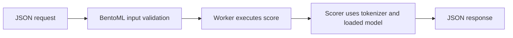
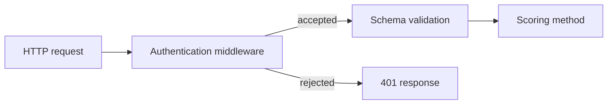
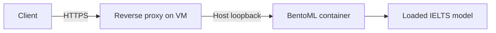
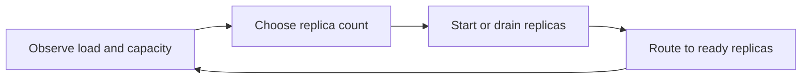

# BentoML: from one prediction to an operated service

A practical course using `saugataroy/ielts-task2-modernbert-base-moe`, uv, GitHub, local Docker, and eventually a cloud VM.

Reference date: 10 October 2026. Project versions: Python 3.12.12, BentoML 1.4.39, PyTorch 2.10.0, Transformers 4.57.6. The linked `latest` documentation can change; check installed APIs before adopting newer examples.

## How to use this course

Read one lesson, do its exercise, explain the result, and then continue. Commands are grouped by lesson; this document is not a script to execute from top to bottom. Run project commands from the repository root. Python and BentoML commands use `uv run`.

There are two kinds of examples:

- **Existing project:** code and commands describing what is already implemented.
- **Future exercise:** a design or change to make during that lesson. Writing this course does not implement it.

Lessons 1 and 2 cover the material already discussed. Their exercises remain useful. Lesson 3 is the next topic. Each lesson includes an answer key under a collapsible heading.

The existing local Docker endpoint is `http://127.0.0.1:3007`. HTTP exercises assume it is running. Lesson 4 explains how to start a source server on a different port. No cloud account is necessary for the early lessons.

## Contents

1. [The execution model](#lesson-1-the-execution-model)
2. [The API contract](#lesson-2-the-api-contract)
3. [Model loading and prediction correctness](#lesson-3-model-loading-and-prediction-correctness)
4. [Project structure, uv, Bentos, and Docker](#lesson-4-project-structure-uv-bentos-and-docker)
5. [Middleware, authentication, and authorization](#lesson-5-middleware-authentication-and-authorization)
6. [Testing and GitHub CI](#lesson-6-testing-and-github-ci)
7. [Health, logs, metrics, and tracing](#lesson-7-health-logs-metrics-and-tracing)
8. [Benchmarking and capacity](#lesson-8-benchmarking-and-capacity)
9. [Workers, threads, async, and admission limits](#lesson-9-workers-threads-async-and-admission-limits)
10. [Adaptive batching](#lesson-10-adaptive-batching)
11. [Queues and background tasks](#lesson-11-queues-and-background-tasks)
12. [Optimizing this model](#lesson-12-optimizing-this-model)
13. [Operating on a cloud VM](#lesson-13-operating-on-a-cloud-vm)
14. [Replicas, load balancing, and autoscaling](#lesson-14-replicas-load-balancing-and-autoscaling)
15. [Composition and additional serving interfaces](#lesson-15-composition-and-additional-serving-interfaces)
16. [BentoCloud and the wider documentation](#lesson-16-bentocloud-and-the-wider-documentation)

Then use the [capstone](#capstone), [troubleshooting guide](#troubleshooting-guide), and [glossary](#glossary).

## Current project facts

These are the starting conditions, not recommended settings for every workload.

| Area | Current implementation |
| --- | --- |
| Entry point | `service:IELTSScoringService` |
| Prediction endpoint | `POST /score` |
| Input | Original question and essay as strings |
| Output | Four continuous rubric estimates, mean, truncation information, release identity |
| Compute | CPU, float32; one worker, one BentoML request thread, two PyTorch CPU threads |
| Traffic settings | `timeout=30`, `concurrency=4`; no explicit `max_concurrency` |
| Docker run configuration | Two CPUs and 3 GiB memory; host loopback port 3007 maps to container port 3000 |
| Model revision | `ad150d954cc9af7fa848fedeafeef6c28c71e2c6` |
| Batching | Upstream scorer accepts batches; our public endpoint currently scores one essay per call |
| Authentication | Not implemented in the application |
| Background tasks | Not implemented |
| CI | Lint, formatting, dependency-export consistency, and tests excluding real-model integration tests |
| Deployment | Local Docker; VM operations and autoscaling are later exercises |

`traffic.concurrency=4` does not impose a four-request limit on the local container. Read Lesson 9 before interpreting or changing it. The folder cleanup discussed in the conversation also remains separate work; this course documents the existing project.

## Lesson 1: The execution model

**Goal:** explain what starts once, what runs per request, and what consumes model memory.

A project is the source directory. A Service is a Python class registered with BentoML. A Bento is the packaged artifact built from the project. A container image is a runnable distribution of that artifact and its environment. A running container can contain multiple service worker processes. See the [service guide](https://docs.bentoml.com/en/latest/build-with-bentoml/services.html) and [packaging guide](https://docs.bentoml.com/en/latest/get-started/packaging-for-deployment.html).

Our class is registered with `@bentoml.service`. Its constructor contains:

```python
def __init__(self) -> None:
    self.scorer = Scorer(self.model_path)
```

`Scorer` loads the tokenizer and model, configures CPU inference, and performs a warm-up prediction. The resulting object remains available as `self.scorer`.

The constructor runs during each worker's startup. Ten subsequent valid HTTP requests reuse that worker's initialized scorer. A worker restart initializes a new scorer. [Lifecycle documentation](https://docs.bentoml.com/en/latest/build-with-bentoml/lifecycle-hooks.html)



Three controls operate at different levels:

| Control | Role in our synchronous endpoint |
| --- | --- |
| `workers` | Separate service processes; each initializes its own model and tokenizer |
| BentoML `threads` | How many synchronous endpoint calls can execute concurrently within each worker |
| `torch.set_num_threads` | CPU parallelism inside PyTorch operations |

With `workers=2, threads=1`, there are two loaded model instances and up to two simultaneous endpoint method executions. With `workers=1, threads=2`, there is one model instance shared by up to two executions. The shared inference stack must support concurrent access. Extra calls also allocate intermediate tensors, even when weights are shared.

Request threads execute the entire method, including inference. They can improve throughput when work can overlap and hardware has capacity. They are not limited to I/O. Python code holding the GIL cannot execute simultaneously across Python threads, while native computation may run outside that lock. Separate processes have separate interpreters. [Worker documentation](https://docs.bentoml.com/en/latest/build-with-bentoml/parallelize-requests.html)

For a synchronous, non-batched service, `workers × threads` describes the available method execution slots before other limits. It is not requests per second. Hardware, input length, contention, and waiting determine actual performance.

**Practice:** read `service.py` and `ielts_api/inference.py`. Locate model initialization, request handling, and the warm-up. Explain why loading weights inside the request method would add repeated work.

**Checkpoint:** with two workers and three request threads per worker, how many model instances and execution slots exist? Would six slots guarantee six times the throughput?

<details>
<summary>Answer</summary>

Two model instances and up to six synchronous method executions. Throughput is not guaranteed to scale by six: those calls share hardware, and each process uses memory. In our two-CPU container, more runnable work can increase contention.

</details>

## Lesson 2: The API contract

**Goal:** describe valid input, predictable output, and client-visible failures.

The input contract is defined in `ielts_api/schemas.py`:

```python
class EssayInput(BaseModel):
    model_config = ConfigDict(extra="forbid", strict=True)

    question: str = Field(min_length=1, max_length=20000)
    essay: str = Field(min_length=1, max_length=100000)
```

Both fields are required. They must be strings. Unknown fields are rejected. The length limits count characters, and an additional validator rejects whitespace-only text while preserving the original valid text.

These are application decisions. They are not default BentoML limits or the model's token budget.

The service connects the schema to HTTP:

```python
@bentoml.api(input_spec=EssayInput)
def score(self, **payload: str) -> ScoreResponse:
    try:
        return self.scorer.score(**payload)
    except ValueError as exc:
        raise InvalidArgument(str(exc)) from exc
```

`input_spec` validates the top-level JSON fields and passes them as keyword arguments. `**payload` collects them into a dictionary; the second `**payload` expands them into the scorer's arguments. This Pydantic integration also contributes to generated API documentation. [Input/output guide](https://docs.bentoml.com/en/latest/build-with-bentoml/iotypes.html#pydantic)

The output is a `ScoreResponse`, constructed by our scorer. It includes `scores` with TR, CC, LR, and GRA; `task2_mean_estimate`; `track`; `max_tokens`; `truncated`; and `release`. Finite-number checks prevent NaN and infinity in our score models.

Schema validation is separate from model-specific validation. A syntactically valid question can still tokenize to an excessive length; the scorer rejects that before the forward pass. `InvalidArgument` maps that application error to HTTP 400. Unexpected faults should remain server errors that can be investigated. [Error-handling guide](https://docs.bentoml.com/en/latest/build-with-bentoml/error-handling.html)

**Practice:** with the local container running, submit a valid request:

```bash
curl -i http://127.0.0.1:3007/score \
  -H 'Content-Type: application/json' \
  --data-binary @examples/essay.json
```

Then submit an unsupported field:

```bash
curl -i http://127.0.0.1:3007/score \
  -H 'Content-Type: application/json' \
  -d '{"question":"Should transport be free?","essay":"Affordable transport benefits residents.","temperature":0.7}'
```

Expected outcomes: the first request returns 200 and a prediction; the second returns 400. Validation of the second request fails before the endpoint method executes. These expectations describe the existing implementation, not a claim that this document executed the requests.

Inspect the machine-readable contract:

```bash
curl -fsS http://127.0.0.1:3007/docs.json | uv run python -m json.tool
```

The browser UI is at `http://127.0.0.1:3007/`. The OpenAPI document describes the wire format; do not invent request nesting from a Python variable name.

**Checkpoint:** why is `"essay": "   "` rejected even though its length exceeds zero? Does HTTP 200 prove the essay was graded accurately?

<details>
<summary>Answer</summary>

Our custom `nonblank` validator rejects whitespace-only values. HTTP 200 establishes successful request handling; predictive accuracy needs separately labeled evaluation data.

</details>

## Lesson 3: Model loading and prediction correctness

**Goal:** preserve the model author's intended computation and identify the exact model being served.

There are two separate activities: locating model files and loading them into a framework. Our class-level `HuggingFaceModel` reference declares the files as a Bento dependency. `Scorer` then loads those files into PyTorch and Transformers. Putting the reference at class scope allows packaging to discover it. `BentoModel` serves a similar dependency role for a model registered in BentoML's Model Store. [Model management](https://docs.bentoml.com/en/latest/build-with-bentoml/model-loading-and-management.html)

Our model requires a custom inference path. From the pinned implementation:

1. Tokenize the question and essay as a pair.
2. Keep at most 1,024 combined tokens, including special tokens.
3. Truncate only the essay when necessary.
4. Construct an essay-token mask.
5. Run the ModernBERT encoder and pool essay-token representations.
6. Run the custom scoring head to produce four rubric estimates.

The author-provided `model.score(tokenizer, questions, essays)` expects equally sized lists. Our public API supplies lists containing one question and one essay. Replacing this with a generic text-classification pipeline would need a correctness comparison because the custom essay mask and head matter. Read the [pinned model card](https://huggingface.co/saugataroy/ielts-task2-modernbert-base-moe/blob/ad150d954cc9af7fa848fedeafeef6c28c71e2c6/README.md) alongside `ielts_api/vendor/modeling_ielts.py`.

The custom MoE head evaluates its experts and combines their outputs with gates. Its name alone does not imply sparse expert execution or proportional compute savings.

Our service uses `.eval()` and the upstream scoring method uses `torch.inference_mode()`. Evaluation mode changes modules such as dropout; inference mode removes gradient-related overhead. They address different concerns. [PyTorch inference mode](https://docs.pytorch.org/docs/2.10/generated/torch.autograd.grad_mode.inference_mode.html)

Reproducibility has several identities:

| Identity | What it tracks |
| --- | --- |
| Git commit | Application source |
| Hugging Face revision | Model, tokenizer, and associated repository files |
| `uv.lock` | Resolved dependency versions |
| Bento tag | Packaged application artifact |
| Container digest | The particular image distributed and deployed |

`model.lock.json` is our additional checksum manifest, not a required BentoML filename. `artifacts.py` checks those files and the vendored custom code. A checksum matches an expected artifact; it does not establish that the artifact is accurate or trustworthy by itself.

Our scores remain continuous estimates. TR means Task Response, CC Coherence and Cohesion, LR Lexical Resource, and GRA Grammatical Range and Accuracy. The arithmetic mean is not an official IELTS Writing band. A successful parity test means our serving path reproduces the reference computation; it is not a grading-quality evaluation.

**Practice:** inspect `model.lock.json`, `inference.py`, and the vendor scorer. Locate the model revision, maximum token length, truncation policy, mask construction, and output mean. Then compare the normal, short, and truncated cases in `tests/fixtures/reference.json`.

**Checkpoint:** why could changing only the tokenizer alter predictions? Why should a truncated response be visible to the caller?

<details>
<summary>Answer</summary>

The tokenizer determines token IDs, boundaries, special tokens, and which essay content reaches the model. Truncation means the prediction reflects only the retained text; callers need that information to interpret the estimate.

</details>

## Lesson 4: Project structure, uv, Bentos, and Docker

**Goal:** distinguish source organization, dependency management, packaging, and execution.

BentoML does not enforce a universal folder tree. Its [official quickstart](https://github.com/bentoml/quickstart) is service-centered. Additional Python modules, tests, CI, and documentation follow the application's needs.

The important parts of our repository are:

```text
service.py              BentoML entry point and runtime Image
ielts_api/              Scoring logic, schemas, artifacts, custom model code
pyproject.toml          Dependencies and development-tool configuration
uv.lock                 Resolved dependency versions
requirements.txt        Generated runtime export used by Image
.python-version         Local Python selection
.bentoignore            Exclusions from the Bento
tests/                  Contract and real-model tests
.github/workflows/       CI
docs/                   Lessons and explanations
```

`.agents/skills/` is installed assistant tooling. `scripts/` contains our project helpers. Neither directory is a BentoML application-layout requirement.

The runtime is configured with `bentoml.images.Image` in `service.py`. That is the current recommended configuration style; `bentofile.yaml` remains supported. Keeping `pyproject.toml` for uv is appropriate. [Runtime environment](https://docs.bentoml.com/en/latest/build-with-bentoml/runtime-environment.html)

Our dependency flow is:

```text
pyproject.toml → uv.lock → generated requirements.txt → Bento runtime Image
```

Use `uv sync --locked` to install the locked project environment without silently updating the lock. The current exporter omits development dependencies and BentoML itself because BentoML injects its version into the container environment. It also preserves the intended CPU PyTorch package source. Do not replace that helper with an arbitrary `pip freeze`. [uv project environment](https://docs.astral.sh/uv/guides/projects/#managing-dependencies)

**Existing project: start a source server.** Port 3008 avoids the existing Docker endpoint on 3007. The model-fetch command may download files if they are absent.

```bash
uv sync --locked
uv run python -m scripts.fetch_model
uv run bentoml serve service:IELTSScoringService --host 127.0.0.1 --port 3008
```

In another terminal:

```bash
uv run python -m scripts.verify_http --url http://127.0.0.1:3008
```

`service:IELTSScoringService` means “load the attribute `IELTSScoringService` from the Python module `service`.” Stop this source server with Ctrl+C when finished.

The packaging sequence is:


**Future packaging exercise:** build once, note the actual generated tag, and use that tag consistently:

```bash
uv run bentoml build -o tag
uv run bentoml list
```

Set `BENTO_TAG` to the printed `name:version` value, without the `__tag__:` output prefix. For this Mac's local arm64 exercise:

```bash
uv run bentoml containerize "$BENTO_TAG" -t "$BENTO_TAG" --opt platform=linux/arm64
uv run python -m scripts.smoke_container "$BENTO_TAG"
```

The smoke helper creates its own temporary container, exercises predictions without network access or host model-cache mounts, and removes that container. A different CPU architecture needs its own build and verification. [Container packaging](https://docs.bentoml.com/en/latest/get-started/packaging-for-deployment.html)

Our release helper, `uv run python -m scripts.build_bento`, adds a clean-Git requirement and commit-based versioning. That is our release policy, not a prerequisite of the raw `bentoml build` command. Do not run both build paths without intending to create multiple artifacts.

`.bentoignore` excludes files from packaging; `.gitignore` excludes files from Git. They solve different problems. The generated Bento has its own internal structure, which you inspect rather than maintain as source. [Build options](https://docs.bentoml.com/en/latest/reference/bentoml/bento-build-options.html)

**Checkpoint:** does committing a model file to Git automatically declare it as a Bento dependency? Does an arm64 image prove an amd64 VM deployment will work?

<details>
<summary>Answer</summary>

No to both. Dependency declaration and packaging must include what runtime needs. CPU architecture, package wheels, native libraries, and target execution must also be compatible and verified.

</details>

## Lesson 5: Middleware, authentication, and authorization

**Goal:** protect inference at the HTTP boundary and understand which security responsibility belongs where.

Authentication verifies a credential. Authorization decides which actions that credential permits. Encryption protects traffic in transit. A request limit controls resource consumption. These are separate responsibilities.

Self-hosted BentoML provides the middleware integration point. The application or a gateway supplies API-key/JWT verification and permissions. BentoCloud offers managed protected endpoints with tokens. A private GitHub repository does not authenticate callers to a running API. [ASGI integration](https://docs.bentoml.com/en/latest/build-with-bentoml/asgi.html), [BentoCloud authorization](https://docs.bentoml.com/en/latest/scale-with-bentocloud/deployment/configure-deployments.html#authorization)



The service-level hook is `IELTSScoringService.add_asgi_middleware(...)`. It wraps the service's ASGI application, including mounted applications. A FastAPI dependency on a mounted route only protects that route; it does not automatically protect BentoML's `/score`.

**Future exercise: an API-key middleware.** The following teaching implementation is not present in the application. Put it in an application module during the exercise, then register it after the service class. It uses a single bearer key, not a user database or role system.

```python
import os
import secrets

from starlette.datastructures import Headers
from starlette.responses import JSONResponse


class ApiKeyMiddleware:
    def __init__(self, app):
        self.app = app
        key = os.environ.get("IELTS_API_KEY")
        if not key:
            raise RuntimeError("IELTS_API_KEY must be configured")
        self.expected = key.encode("utf-8")

    async def __call__(self, scope, receive, send):
        if scope["type"] not in {"http", "websocket"}:
            return await self.app(scope, receive, send)

        public_probe = (
            scope["type"] == "http"
            and scope["method"] in {"GET", "HEAD"}
            and scope["path"] in {"/livez", "/readyz", "/healthz"}
        )
        if public_probe:
            return await self.app(scope, receive, send)

        header = Headers(scope=scope).get("authorization", "")
        scheme, separator, token = header.partition(" ")
        valid = (
            bool(separator)
            and scheme.lower() == "bearer"
            and secrets.compare_digest(token.encode("utf-8"), self.expected)
        )
        if not valid:
            if scope["type"] == "websocket":
                await send({"type": "websocket.close", "code": 1008})
                return
            response = JSONResponse(
                {"detail": "Invalid or missing credentials"},
                status_code=401,
                headers={"WWW-Authenticate": "Bearer"},
            )
            return await response(scope, receive, send)

        await self.app(scope, receive, send)
```

Register the class from its module:

```python
IELTSScoringService.add_asgi_middleware(ApiKeyMiddleware)
```

Inject the key at runtime, outside Git and image layers. With the key already set in the shell, Docker's `-e IELTS_API_KEY` passes it without putting its literal value in the command. Use HTTPS on the public VM endpoint. Do not log authorization headers. The exception list above is for our default unprefixed health routes; revisit it if route prefixes change. `/metrics` and the documentation remain protected by this example.

A shared key permits anyone holding it to access the protected routes. Later, per-client keys or verified JWT claims can support scopes such as `score:write` and separate administrative permissions. Decoding a JWT without verifying signature, issuer, audience, and expiry does not authenticate it.

CORS controls browser cross-origin behavior; it does not prevent arbitrary clients from calling an endpoint. Browser preflight handling and middleware order need their own test if a browser frontend is added.

**Practice:** implement this only when doing the security lesson. Verify missing key → 401, wrong key → 401, valid key and valid input → 200, valid key and invalid input → 400, and probes still work. Confirm unauthorized requests do not reach the scorer. Adapt WebSocket credentials if that interface is later introduced.

**Checkpoint:** if the key is valid but the caller lacks an action's required permission, what status describes that failure?

<details>
<summary>Answer</summary>

403 Forbidden. Authentication succeeded, but authorization failed. Our single-key example does not yet implement distinct permissions.

</details>

## Lesson 6: Testing and GitHub CI

**Goal:** distinguish a working web server from a correctly packaged model service.

Our verification layers answer different questions:

| Layer | Question |
| --- | --- |
| Schema tests | Do blank, missing, wrong-type, oversized, or extra inputs behave as intended? |
| Prediction regression tests | Does the serving implementation preserve reference outputs within a justified tolerance? |
| HTTP tests | Are routing, validation, status codes, and serialization correct? |
| Container smoke tests | Does the packaged artifact work without relying on the developer's environment? |
| Evaluation dataset | Are predictions useful and accurate for representative essays? |

BentoML supports direct service calls, in-process ASGI tests, and real HTTP integration tests. Their coverage differs. An in-process test will not discover a Docker architecture mismatch. [Testing documentation](https://docs.bentoml.com/en/latest/build-with-bentoml/testing.html)

**Existing project commands:**

```bash
uv run ruff check .
uv run ruff format --check .
uv run python -m scripts.export_requirements --check
uv run pytest -q -m 'not integration'
```

After the pinned model files are available:

```bash
uv run pytest -q -m integration
```

The integration fixture opens `TestClient(IELTSScoringService.to_asgi())` as a context manager so service startup and teardown run. It builds one ASGI app per fixture scope; repeatedly creating apps can conflict with process-global metric registrations in this version.

An output comparison needs a reason for its tolerance. Our fixture records an absolute tolerance. A faster backend should not be accepted merely by widening that tolerance until the test passes. Investigate the numerical change, check representative data, and document the acceptable error.

Current GitHub Actions checks the lightweight source suite. It does not run the full real-model suite or validate the Docker image. Read `.github/workflows/ci.yml` rather than interpreting a green badge as evidence for every test layer.

For a later release pipeline, promote an image that passed its checks. Record its digest and the source/model identities. Rebuilding from the same tag during deployment can introduce a different artifact. A release should be traceable back to the evidence that justified it.

**Future exercise:** introduce a harmless contract change on a learning branch, observe the relevant test fail, then fix the implementation or intentionally update the contract and its tests. Do not alter the frozen prediction fixture just to conceal a mismatch.

**Checkpoint:** all schema tests pass, but the tokenizer is missing from the image. Which verification layer should catch that?

<details>
<summary>Answer</summary>

A fresh container smoke test that initializes the model and exercises a real prediction. A test that mounts the host Hugging Face cache could conceal the packaging error.

</details>

## Lesson 7: Health, logs, metrics, and tracing

**Goal:** determine whether a service is available, where time goes, and whether predictions remain useful.

Health checks have different purposes. Liveness asks whether the process is functioning. Readiness asks whether traffic should be routed to it. Our constructor performs model loading and warm-up before initialization completes. A probe is still weaker evidence than a prediction with a checked response body. Custom readiness logic can also check required downstream resources. [Lifecycle and health hooks](https://docs.bentoml.com/en/latest/build-with-bentoml/lifecycle-hooks.html)

Three observation tools complement each other:

- **Logs:** individual events, errors, startup details, and request correlation IDs.
- **Metrics:** aggregated counts, durations, gauges, and distributions suitable for graphs and alerts.
- **Traces:** the timing and relationships of operations within a request.

BentoML exposes Prometheus-style metrics at `/metrics`, including request counts, in-progress requests, and duration histograms. Histograms record bucketed distributions from which a monitoring system can estimate percentiles. [Metrics documentation](https://docs.bentoml.com/en/latest/build-with-bentoml/observability/metrics.html)

```bash
curl -fsS http://127.0.0.1:3007/readyz
curl -fsS http://127.0.0.1:3007/metrics
docker logs --tail 50 ielts-inference-api-local
docker stats --no-stream ielts-inference-api-local
```

Once authentication is introduced, metric access must follow its policy. Health checks should expose minimal operational information.

For this scorer, useful measurements include successful requests per second, error rates, p95 latency, CPU/memory usage, tokenization time, inference time, input token lengths, truncation rate, and model revision. Use bounded labels such as endpoint and version. Raw essays, user IDs, and request IDs create excessive metric label cardinality and should not become metric labels.

Operational metrics cannot tell us that an essay estimate is accurate. Model monitoring additionally needs representative evaluation, rubric error distributions, drift investigation, and appropriately handled human feedback. An increase in average predicted scores might reflect a new input population rather than an improved model.

BentoML integrates with OpenTelemetry for tracing. A useful trace for this application would separate validation, tokenization, inference, and serialization. Configure sampling and exporters explicitly; merely installing a tracing package does not produce a useful trace backend. [Tracing documentation](https://docs.bentoml.com/en/latest/build-with-bentoml/observability/tracing.html)

**Future exercise:** collect metrics while making a small number of requests. Identify which counters changed. Then time tokenization and the forward pass separately. Avoid storing raw essay bodies in routine logs.

**Checkpoint:** `/livez` succeeds, but model initialization is still in progress. Should a load balancer send inference requests to this instance?

<details>
<summary>Answer</summary>

No. It should use readiness to determine whether the instance can receive traffic. Restarting a merely slow-starting process repeatedly can prevent it from ever becoming ready.

</details>

## Lesson 8: Benchmarking and capacity

**Goal:** measure a workload before selecting concurrency, batching, or hardware settings.

Latency is the duration of one request. Throughput is the number of completed requests per unit time. Concurrency is how many requests are in progress. These quantities are related but are not interchangeable.

p50 is the median latency. p95 means approximately 95% of measured requests finished within that duration. State the population: a p95 calculated only over successful requests can look healthy while many requests fail. Always report error and timeout rates alongside percentiles.

Warm-up and cold start answer different questions. A warm test measures an initialized service. A cold-start test includes process startup and model initialization. Keep both, but do not mix them into one unexplained average.

Our benchmark dataset should include short, typical, near-limit, and truncated essays. Input length affects tokenization, padding, and encoder computation. Repeating one short example proves little about a workload containing long essays.

**Future exercise: measure a small baseline.** This script uses existing development dependency `httpx`. Save it as a temporary lab script when doing this lesson and run it with `uv run python PATH_TO_SCRIPT`. It reuses connections and tests one concurrency setting at a time.

```python
import asyncio
import json
import math
import time
from pathlib import Path

import httpx


async def measure(concurrency, requests=40):
    payload = json.loads(Path("examples/essay.json").read_text())
    gate = asyncio.Semaphore(concurrency)
    successes = []
    failures = []
    limits = httpx.Limits(max_connections=concurrency)
    async with httpx.AsyncClient(
        base_url="http://127.0.0.1:3007", timeout=35, limits=limits
    ) as client:
        warmup = await client.post("/score", json=payload)
        warmup.raise_for_status()

        async def one():
            async with gate:
                started = time.perf_counter()
                try:
                    response = await client.post("/score", json=payload)
                    elapsed = time.perf_counter() - started
                    if response.status_code == 200:
                        successes.append(elapsed)
                    else:
                        failures.append(str(response.status_code))
                except httpx.HTTPError as exc:
                    failures.append(type(exc).__name__)

        started = time.perf_counter()
        await asyncio.gather(*(one() for _ in range(requests)))
        duration = time.perf_counter() - started

    values = sorted(successes)
    p95 = values[math.ceil(0.95 * len(values)) - 1] if values else None
    print({"concurrency": concurrency, "successes": len(values),
           "failures": failures, "successful_rps": len(values) / duration,
           "successful_p95_seconds": p95})


async def main():
    for concurrency in (1, 2, 4):
        await measure(concurrency)


asyncio.run(main())
```

This is an introductory, fixed-concurrency experiment. It excludes waiting for the client-side semaphore from each request's latency, includes server waiting after dispatch, uses one payload, and has a small sample. It does not validate prediction correctness or simulate a fixed incoming request rate. Add authorization headers when testing the future protected service.

For release evidence, run correctness checks separately, use representative inputs, increase sample size, repeat runs, and record hardware, image digest, settings, load-generator location, and resource usage. A generator on the same machine can compete with the server. Arrival-rate tests are also needed: a closed-loop client slows its own arrivals when the server slows, potentially concealing queue growth.

Record results rather than inventing target numbers:

| Configuration | Input mix | Successful RPS | p50 | p95 | Errors | Peak memory |
| --- | --- | --- | --- | --- | --- | --- |
| Baseline | To measure | To measure | To measure | To measure | To measure | To measure |

A practical service objective might specify that a chosen fraction of valid requests complete within an agreed duration at an agreed workload. The duration and workload should come from product requirements and measurements. BentoCloud also recommends load testing before choosing its capacity setting. [Concurrency guidance](https://docs.bentoml.com/en/latest/scale-with-bentocloud/scaling/autoscaling.html#concurrency)

**Checkpoint:** configuration B has higher successful RPS but much worse p95 and more timeouts. Is it automatically an improvement?

<details>
<summary>Answer</summary>

No. Evaluate throughput together with the latency objective, failure rate, correctness, resource use, and cost. More work completed in aggregate may still produce an unacceptable user experience.

</details>

## Lesson 9: Workers, threads, async, and admission limits

**Goal:** allow useful parallel work while bounding the load accepted by the service.

Return to the three controls from Lesson 1. Request threads can run inference; they do not create extra model copies. Workers create independent service instances. PyTorch threads participate in numerical operations within those instances. Raising all three together can make runnable computation exceed the available CPUs. [PyTorch multiprocessing guidance](https://docs.pytorch.org/docs/2.10/notes/multiprocessing.html#cpu-oversubscription)

For our two-CPU container, compare these candidates under the same workload:

| Candidate | Workers | Request threads per worker | PyTorch threads per worker | Model instances |
| --- | --- | --- | --- | --- |
| Existing baseline | 1 | 1 | 2 | 1 |
| Process experiment | 2 | 1 | 1 | 2 |
| Shared-model experiment | 1 | 2 | 1 | 1 |

The second candidate may improve throughput while using more memory. The third may avoid a second weight copy but requires concurrent-access checks for the tokenizer and model. In particular, tokenization libraries can have mutable padding/truncation configuration. Do not assume the complete inference stack is safe merely because model weights are read-only. Test mixed input lengths repeatedly for exceptions and prediction parity.

These are experimental candidates, not measured winners. Internal thread-pool behavior also varies by backend; `workers × request threads × PyTorch threads` is not an exact operating-system thread count.

`async def` has a different purpose. It lets a coroutine yield control while awaiting I/O or another awaitable operation. Declaring the CPU scoring method async and then directly calling blocking inference can block the event loop. Use a synchronous API for our current blocking scorer, or explicitly offload blocking work when composing it with asynchronous operations. [Synchronous and asynchronous Services](https://docs.bentoml.com/en/latest/build-with-bentoml/services.html#synchronous-and-asynchronous-apis)

The admission settings must also be distinguished:

| Setting | Meaning |
| --- | --- |
| `threads` | Synchronous method execution capacity per worker |
| `traffic.max_concurrency` | Server admission limit; excess requests can be rejected |
| `traffic.concurrency` | Intended capacity used by BentoCloud's routing/scaling behavior |
| `traffic.external_queue` | BentoCloud-managed buffering of excess requests |
| `traffic.timeout` | Server response timeout |

Our existing `concurrency=4` is not a local four-request limit. A future local experiment could set `max_concurrency=4` while retaining one request thread: one method call executes and other admitted requests can wait for an execution slot. The limit does not create four compute lanes. [Traffic configuration](https://docs.bentoml.com/en/latest/reference/bentoml/configurations.html#traffic)

In installed BentoML 1.4.39, the admission middleware returns HTTP 429 when its limit is occupied. Its service budget is distributed across workers using a rounded-up per-worker value, so an uneven split is not a perfectly exact global semaphore. Check behavior with the actual worker configuration. Health/metrics paths bypass this middleware's admission check; that says nothing about their authentication policy.

A response timeout also does not guarantee that underlying native model computation immediately stops. Design admission limits and client retries to avoid building a pile of expensive work after callers have given up. Streaming introduces additional timeout considerations because response transmission can begin before all computation finishes.

**Future exercise:** in an isolated learning run, configure an explicit admission limit, submit more concurrent requests than it admits, and record accepted requests, 429s, timeouts, latency, and readiness. Change one control at a time. Restore the baseline after the experiment.

**Checkpoint:** with one worker, one request thread, and a local admission limit of four, do four accepted requests imply four simultaneous model calls?

<details>
<summary>Answer</summary>

No. There is one synchronous execution slot. Other admitted requests may wait. Admission capacity and execution capacity describe different stages.

</details>

## Lesson 10: Adaptive batching

**Goal:** combine compatible inputs into efficient model execution while preserving response mapping and latency.

Suppose four requests arrive close together. A batch-capable model can sometimes process their inputs in one vectorized forward pass more efficiently than four separate calls. BentoML's adaptive dispatcher gathers work and adjusts batching based on observed traffic and execution time. Batching is disabled unless enabled for the API. [Adaptive batching](https://docs.bentoml.com/en/latest/get-started/adaptive-batching.html)

The important controls are `batchable`, `max_batch_size`, `max_latency_ms`, and `batch_dim`. A latency setting is a dispatcher budget that includes batching/processing considerations; it should not be described as only a fixed sleep before execution or as a universal end-to-end client guarantee.

Here is a small **standalone teaching example**, separate from the IELTS application:

```python
import bentoml


@bentoml.service
class LengthService:
    @bentoml.api(batchable=True, max_batch_size=8, max_latency_ms=1000)
    def lengths(self, texts: list[str]) -> list[int]:
        return [len(text) for text in texts]
```

This demonstrates the batch input/output shape. It does not demonstrate a performance improvement: calculating string lengths is cheap. The numbers are illustrative, not tuned IELTS settings.

The installed batch API accepts one batchable argument in addition to an optional context. For IELTS, that argument could be a list of objects, each holding its question and essay. Preserve each pair throughout tokenization and preserve output correspondence with the assembled input batch. Arrival order across unrelated client requests should not be assumed.

Our upstream model already supports `model.score(tokenizer, questions, essays)` with multiple pairs. Our `Scorer.score` and public API currently pass singleton lists. Turning on `batchable=True` alone would not finish the integration.

A useful design keeps `/score` as a one-essay public contract and introduces a batch-capable inference Service called by an asynchronous facade. `bentoml.depends()` can connect them. The facade must allow enough concurrent work to reach the batcher; a synchronous facade with one thread can prevent a useful batch from forming.

Batching creates application-specific decisions:

- A long essay can increase padding work for shorter essays in its batch.
- Larger batches require more activation memory.
- Waiting briefly for a batch can hurt low-traffic latency.
- Invalid items need a defined failure policy. Validate at the facade before merging requests, and decide how model-specific failures propagate.
- Numerical outputs can differ slightly with batch shape. Check pairing, truncation flags, and justified numerical tolerances.

**Future exercise:** first compare the upstream scorer on separate examples versus a combined batch outside HTTP. Verify output mapping. Then integrate batching on a branch, load test several batch sizes and latency budgets, and compare throughput, p95, memory, and error rate against the non-batched baseline.

**Checkpoint:** if a batch contains one short essay and one near-limit essay, why can its cost differ from a batch containing two short essays?

<details>
<summary>Answer</summary>

The tokenizer pads inputs for joint execution, and longer sequences change attention and activation work. The actual cost depends on the attention backend and model implementation, so it must be measured.

</details>

## Lesson 11: Queues and background tasks

**Goal:** choose where work waits and define what happens when a process fails.

“Queue” can mean several things:

| Mechanism | Client experience | Durability question |
| --- | --- | --- |
| Waiting for a synchronous execution slot | HTTP request stays open | Work is tied to the serving process/request |
| Adaptive batch waiting | HTTP request stays open while inputs are grouped | It is a short execution buffer |
| Background task | Submission returns an ID; result is retrieved later | Depends on the task backend and deployment |
| Durable broker and workers | Job persists independently of a particular HTTP connection | Requires explicit acknowledgment, retry, and persistence design |
| BentoCloud external request queue | Platform buffers excess incoming requests | Managed-platform behavior, not enabled on a plain VM by that flag |

Queues absorb bursts; they do not create compute capacity. In a deliberately simplified example, a worker completes one request per second and three arrive together. Completion times might be approximately one, two, and three seconds. The later requests spend time waiting. This is an illustration, not a measurement of our model.

If arrivals continuously exceed completion capacity, waiting grows until something rejects, expires, fails, or runs out of storage. A production policy therefore needs bounded backlog, deadlines, and a clear overload response.

BentoML provides `@bentoml.task` for background submission and later status/result retrieval. A caller uses an endpoint's `.submit(...)` method, receives a task handle, and can query its status or retrieve the completed result. [Task documentation](https://docs.bentoml.com/en/latest/get-started/async-task-queues.html)

**Future example:** if a task endpoint named `score_later` has been implemented, its client interaction can look like:

```python
import bentoml

with bentoml.SyncHTTPClient("http://127.0.0.1:3007") as client:
    task = client.score_later.submit(question="...", essay="...")
    print(task.id)
    print(task.get_status())
    # Retrieve task.get() after confirming completion.
```

`score_later` does not exist in the current service. Use the installed client's status representation when writing completion checks. Version 1.4.39 uses values including `pending`, `in_progress`, `completed`, `failed`, and `canceled`; do not copy an unrelated status string from an example without checking it.

The local 1.4.39 implementation uses background execution and a SQLite result store. That is not a durable distributed job system with crash recovery merely because result rows exist. The documentation identifies local task behavior as a development facility. In this installed version, local cancellation is also explicitly unsupported. Check retention and recovery behavior before promising a user that a task will survive a restart.

For durable VM jobs, design these responsibilities explicitly:

1. Persist a job and return its identifier.
2. Authenticate access to that job and its result; knowing an ID should not authorize access.
3. Let a worker claim work through the queue's acknowledgment/visibility mechanism.
4. Store the result before acknowledging completion.
5. Retry transient failures with bounded attempts and backoff.
6. Deduplicate repeated submissions or make execution idempotent.
7. Track terminal failures and job expiry.

This is a design exercise; the course has not selected or installed a broker. A job ID is an identifier, not an exactly-once guarantee. A process can finish computation, lose its connection before acknowledgment, and cause the same job to be attempted again.

For interactive IELTS scoring, a bounded synchronous endpoint may be sufficient. A later bulk-import workflow containing thousands of essays has different persistence and progress-reporting requirements. BentoCloud's request queue and autoscaler can be considered separately. [External queue documentation](https://docs.bentoml.com/en/latest/scale-with-bentocloud/scaling/autoscaling.html#external-queue)

**Future exercise:** draw a job's state transitions and describe what happens if the API or worker dies at each transition. Then test restart recovery on whichever backend is chosen, using synthetic essays.

**Checkpoint:** a worker saves a result and crashes before acknowledging the job. What property prevents a repeated attempt from causing harmful duplicate effects?

<details>
<summary>Answer</summary>

Idempotent execution or deduplication keyed by a stable job/request identity. Persisting a result is useful only if retries consult that identity and the state transitions are designed consistently.

</details>

## Lesson 12: Optimizing this model

**Goal:** improve a measured bottleneck while preserving the required prediction behavior.

Optimization starts with a hypothesis. For example: “Long essays dominate p95 because encoder execution dominates request time,” or “Multiple workers improve CPU utilization enough to offset extra memory.” Record a baseline, change one factor, repeat the workload, and compare correctness and cost.

Our current implementation already uses evaluation mode, inference mode, a warm-up, and the model author's SDPA attention path. It explicitly disables the encoder's `reference_compile` setting. Those facts describe our starting code; they do not establish that it is optimally configured.

Work through these candidates in order of the bottleneck they address:

| Candidate | Possible benefit | Evidence needed |
| --- | --- | --- |
| Remove repeated preprocessing | Less CPU work per request | Profile tokenization and preserve token IDs/masks |
| Tune process/request/compute threads | Better CPU use | Throughput, tail latency, memory, concurrent correctness |
| Batch compatible inputs | More efficient forward passes | Batch-size curve, latency budget, output correspondence |
| Choose CPU versus GPU | Different compute capacity and cost | Representative end-to-end workload on target hardware |
| Lower precision | Reduced memory/compute on suitable hardware | Numerical and labeled-quality evaluation |
| Compile supported execution paths | Reduced overhead or optimized kernels | Warm-up/recompilation costs and realistic input shapes |
| Quantize compatible components | Lower weight memory and potentially faster kernels | Backend support, actual speed, and score-quality changes |

This model has repeated tokenization for input checks, forward-pass preparation, and truncation reporting. That makes profiling preprocessing worthwhile. Removing a pass requires preserving the original truncation semantics and returned flags. It is a candidate, not a demonstrated bottleneck.

Sequence length is part of the workload. Shortening the maximum length can improve speed while discarding content relevant to grading. Treat that as a model/product behavior change, not a free infrastructure optimization.

Precision and compilation are backend-dependent. A lower-precision dtype is not automatically faster on a particular CPU. Compilation can add startup time and respond differently to varying shapes. The custom head and essay mask also limit how directly a generic ModernBERT optimization example can be transplanted. [ModernBERT reference](https://huggingface.co/docs/transformers/v4.57.1/en/model_doc/modernbert)

For NVIDIA GPU deployment, the model and tensors must be placed on an appropriate device, the Python environment needs compatible CUDA-enabled packages, and the container host needs GPU support. A service resource declaration alone does not convert our explicit `.to("cpu")` implementation into GPU inference. [BentoML GPU guide](https://docs.bentoml.com/en/latest/build-with-bentoml/gpu-inference.html)

Likewise, the Linux CPU image used on this Mac is a different environment from native Apple GPU execution or a CUDA VM. Measure each target independently. Preserve the CPU FP32 reference path while evaluating a new backend.

Caching has its own contract: an exact prediction cache key must include the original inputs, model revision, and relevant preprocessing settings. It is useful only when repeated requests justify the storage and invalidation complexity. Caching arbitrary essays also requires a deliberate data-retention policy.

**Future exercise:** select one profiled bottleneck. Write down the proposed change, expected effect, workload, accuracy tolerance, memory budget, and rollback condition. Run the comparison and keep the original baseline results, even if the experiment fails.

**Checkpoint:** a quantized model runs faster but changes GRA estimates substantially on certain essays. Is numerical parity with a few examples enough to accept it?

<details>
<summary>Answer</summary>

No. Evaluate representative labeled data and error distributions by rubric and relevant input groups. Decide whether the quality change is acceptable before promoting that backend.

</details>

## Lesson 13: Operating on a cloud VM

**Goal:** move a tested container onto a host that can serve requests, survive restarts, and roll back safely.

A cloud VM supplies a machine. You still operate its container runtime, network entry point, credentials, storage, logs, updates, and release process. The service code can remain familiar while these responsibilities change.

Use an image built and tested for the VM's CPU architecture. Push that image to a registry, then deploy its immutable digest. GitHub access, registry access, host administration, and inference API access are separate credentials. A private source repository alone supplies none of the others.

A useful first topology is:



The reverse proxy terminates TLS and routes requests to a loopback-bound container port. Restrict host ingress to the intended public entry point and your administration path. If the gateway enforces authentication, callers must not be able to bypass it through an exposed model port.

The following is a **future VM exercise**, after the authentication lesson has been implemented and included in a new tested image. Replace the image placeholder with your registry reference. Provision `IELTS_API_KEY` in the runtime environment before running this command; setting that variable on the current image does not add middleware.

```bash
IMAGE_REF='YOUR_REGISTRY/ielts-inference-api@sha256:YOUR_TESTED_DIGEST'
docker run -d \
  --name ielts-inference-api \
  --restart unless-stopped \
  --cpus 2 \
  --memory 3g \
  --publish 127.0.0.1:3000:3000 \
  --env IELTS_API_KEY \
  "$IMAGE_REF"
```

This creates a new container; it is not an update command for an existing container with the same name. The two-CPU/3-GiB values reproduce our starting budget, not a capacity recommendation for an arbitrary VM. Leave memory for the host, proxy, and monitoring. Docker CPU and memory flags enforce limits; the CPU/memory declaration in our BentoML service is not a substitute for them on plain Docker. [Docker resource constraints](https://docs.docker.com/engine/containers/resource_constraints/)

`--restart unless-stopped` addresses container exits and daemon restarts according to Docker's restart policy. It does not restart a running container solely because a health check becomes unhealthy. Configure the Docker daemon to start on host boot and test an actual reboot. Readiness should control traffic routing; monitoring should detect stalled or unhealthy service behavior. [Docker restart policies](https://docs.docker.com/engine/containers/start-containers-automatically/)

Operate a release in stages:

1. Pull the candidate digest and record its release identity.
2. Start it separately, on a different local port, with sufficient resources for old and new containers to coexist.
3. Wait for readiness; run authenticated prediction, invalid-input, and numerical smoke checks.
4. Route traffic to the candidate and watch errors, latency, and resource use.
5. Drain old traffic before stopping the previous container.
6. Retain the previous digest and configuration until the rollback window ends.

If the host cannot fit two model instances during deployment, choose a maintenance window or temporary additional capacity. A rolling update label does not create spare memory.

Shutdown is part of this procedure: stop accepting new work, allow a bounded drain period, and then terminate. Test what the proxy and clients observe when a scoring request is in progress. Lifecycle hooks can clean up application resources, but they do not make in-memory jobs durable. [Lifecycle hooks](https://docs.bentoml.com/en/latest/build-with-bentoml/lifecycle-hooks.html)

The host runbook also needs log rotation, disk-space alerts, security updates, certificate renewal, and recovery instructions. Store durable job records outside a replaceable container. Define retention for any essays or results you persist.

**Future exercise:** write and rehearse a runbook covering deploy, reboot, failed readiness, rollback, and disk pressure. Verify the public HTTPS URL as a caller would, not only from inside the host.

**Checkpoint:** Docker reports that the process is running but its health check fails. Does the restart policy alone guarantee recovery?

<details>
<summary>Answer</summary>

No. A running unhealthy container is different from an exited container. Traffic routing, alerting, and any health-based replacement need an explicit operating mechanism. Diagnose the failure before creating a restart loop.

</details>

## Lesson 14: Replicas, load balancing, and autoscaling

**Goal:** increase service capacity across containers while keeping latency and failure behavior predictable.

A worker is a process inside a service container. A replica is another running copy of that service deployment. Replicas have independent memory and initialization. A load balancer distributes traffic among ready replicas.

For our synchronous, non-batched design, assuming one initialized scorer per worker:

```text
model instances = replicas × workers per replica
method execution slots = replicas × workers × request threads
```

Two replicas, two workers per replica, and two request threads per worker mean four model instances and up to eight method executions before other limits. Those numbers still say nothing directly about requests per second.

Horizontal scaling adds replicas. Vertical scaling gives a replica more resources. Adding another container to the same already-saturated two-CPU machine does not add CPU capacity. Separate replicas also provide limited failure isolation if they all live on the same host.

Before adding an autoscaler, measure the sustainable successful throughput of one replica under a latency target. An illustrative calculation: if a tested replica sustains 2 requests/second within the target and expected traffic is 5 requests/second, `ceil(5 / 2) = 3` is a starting count before headroom. These are invented teaching numbers. Real capacity depends on essay lengths, bursts, contention, and the operating margin you choose.

Little's Law helps check a stable system: average in-flight work equals arrival rate multiplied by average time in the system, `L = λW`. Keep units consistent and include waiting in the chosen system boundary. This relationship uses averages; it does not determine a p95 latency guarantee or size a queue for every burst.

An autoscaler closes a control loop:



Its reaction takes time. A new replica must obtain resources, start the image, load weights, and become ready. A queue can absorb a bounded burst during that delay; it cannot create compute capacity. Clients still have deadlines. Configure minimum/maximum capacity, stabilization behavior, overload handling, and a clear scale-in drain policy.

BentoCloud provides a concurrency-based autoscaling mechanism and an optional external request queue. `traffic.concurrency` participates in that platform's capacity configuration. A plain Docker VM needs its own load balancer and scaling controller; the same setting does not launch VMs or containers there. [BentoCloud concurrency and autoscaling](https://docs.bentoml.com/en/latest/scale-with-bentocloud/scaling/autoscaling.html)

Keep replicas interchangeable. A request should not require a particular process's local dictionary to find a user's job. Shared durable state belongs in an appropriate external store. Retries can reach a different replica, so preserve request identity and idempotency where repeated side effects matter.

Load-balancing behavior also affects long-lived connections and uneven request sizes. A replica handling several long essays may have less spare capacity than one handling short inputs. Compare latency and in-flight work across replicas rather than looking only at aggregate CPU.

**Future exercise:** run two isolated replicas with a load balancer in a controlled environment. Confirm both serve traffic, remove one from rotation, and observe in-flight requests. Compare the result with a single replica under the same total CPU and memory budget.

**Checkpoint:** if two replicas each have a two-CPU quota on a VM with two CPUs total, have you created four CPUs of sustained compute?

<details>
<summary>Answer</summary>

No. Quotas limit consumption; they do not manufacture physical capacity. The containers compete for the host's available CPU, alongside other processes. Benchmark the host as a whole.

</details>

## Lesson 15: Composition and additional serving interfaces

**Goal:** recognize when another Service or interface solves a real requirement.

Our IELTS API currently has one model and a small request path. A second Service becomes useful when components need different hardware, independent scaling, or separate lifecycles. For example, a future pipeline could have a CPU ingestion stage and a GPU inference stage. Every boundary also introduces serialization, communication, and another failure mode.

`bentoml.depends()` declares a Service dependency. This standalone toy example illustrates composition without changing the IELTS preprocessing:

```python
import bentoml


@bentoml.service
class WordCounter:
    @bentoml.api
    def count(self, text: str) -> int:
        return len(text.split())


@bentoml.service
class TextReport:
    counter = bentoml.depends(WordCounter)

    @bentoml.api
    def report(self, text: str) -> dict[str, int]:
        return {"words": self.counter.count(text)}
```

The call resembles a Python method invocation, but service communication can cross a process or network boundary. Use an appropriate async client/proxy for async orchestration rather than calling a blocking client from the event loop. Deployment must supply routing and capacity for every dependency; a single plain-Docker container command does not provision an arbitrary distributed architecture. [Distributed Services](https://docs.bentoml.com/en/latest/build-with-bentoml/distributed-services.html)

Other interfaces address different response shapes:

| Interface | Useful requirement | Design question |
| --- | --- | --- |
| Ordinary JSON response | One completed score | What is the timeout and overload behavior? |
| Streaming response | Incrementally produced output | What frames a chunk, and what happens on disconnect? |
| WebSocket | Bidirectional, ongoing interaction | Who owns connection state and bounds buffered work? |
| Mounted ASGI app | Additional custom HTTP routes | Do middleware, route prefixes, and lifecycle handling cover them? |
| Gradio UI | Interactive demonstration | How are API access, privacy, and inference cost controlled? |

Our scorer produces rubric estimates after a forward pass. Streaming does not make that calculation progressively available. If a future job API reports “queued,” “running,” and “completed,” those are job states, not partial model scores. For actual streaming, account for proxy buffering, client cancellation, and a total connection budget. For WebSockets, authenticate the handshake and test how credentials are supplied by the intended client.

Use the relevant interface guide when implementing it: [streaming](https://docs.bentoml.com/en/latest/build-with-bentoml/streaming.html), [WebSockets](https://docs.bentoml.com/en/latest/build-with-bentoml/websocket.html), [ASGI](https://docs.bentoml.com/en/latest/build-with-bentoml/asgi.html), and [Gradio](https://docs.bentoml.com/en/latest/build-with-bentoml/gradio.html).

Template arguments solve a different problem: reusing one service definition with validated settings at serve/build time. For a future standalone example:

```python
import bentoml
from pydantic import BaseModel, Field


class ServiceArguments(BaseModel):
    workers: int = Field(default=1, ge=1)


args = bentoml.use_arguments(ServiceArguments)


@bentoml.service(workers=args.workers)
class ExampleService:
    @bentoml.api
    def echo(self, text: str) -> str:
        return text
```

For that example, `uv run bentoml serve service:ExampleService --arg workers=2` selects a value. Record build-time argument choices with the release. Keep secrets in the runtime secret mechanism; a reusable build argument is not a secret store. Changing the IELTS model argument also requires keeping the model manifest and prediction reference consistent. [Template arguments](https://docs.bentoml.com/en/latest/build-with-bentoml/template-arguments.html)

**Future exercise:** draw one plausible extension to the IELTS application. Mark the new boundary, its input/output contract, timeout, failure behavior, and independent scaling requirement. If there is no such requirement, keep the single-Service design.

**Checkpoint:** will moving tokenization into a separate Service necessarily speed up scoring?

<details>
<summary>Answer</summary>

No. It may allow independent resource allocation, but adds communication and serialization. It can also change the tokenizer/encoder contract. Measure the full pipeline and preserve preprocessing correctness before accepting the change.

</details>

## Lesson 16: BentoCloud and the wider documentation

**Goal:** understand the managed platform's role and know which documentation to revisit for a new workload.

Your chosen deployment path is local Docker followed by a cloud VM. BentoCloud is another operating option for the same framework, with platform-managed deployment capabilities. Compare responsibilities before selecting a platform:

| Responsibility | Plain Docker on your VM | BentoCloud |
| --- | --- | --- |
| Service implementation and model correctness | Yours | Yours |
| API schema and preprocessing | Yours | Yours |
| Host and container operation | You assemble the operating setup | Platform deployment workflow |
| Endpoint protection | Application middleware or gateway | Protected endpoint configuration and API tokens |
| Replica scaling | Your infrastructure/controller | Platform scaling configuration |
| Secrets | Your runtime provisioning mechanism | Platform secret management |
| Rollout and rollback | Your tested deployment procedure | Managed deployment features, still requiring your acceptance criteria |

Cloud credentials have distinct purposes. The developer or CI identity manages deployments; an inference caller needs access to the protected endpoint. Grant only the relevant permissions and keep staging credentials separate from production. Read [API token management](https://docs.bentoml.com/en/latest/scale-with-bentocloud/manage-api-tokens.html), [endpoint authorization](https://docs.bentoml.com/en/latest/scale-with-bentocloud/deployment/configure-deployments.html#authorization), and [secret management](https://docs.bentoml.com/en/latest/scale-with-bentocloud/manage-secrets-and-env-vars.html).

A canary rollout sends a portion of traffic to a candidate release while the stable release continues serving. Decide the acceptance criteria before directing traffic: error rate, latency, capacity, numerical changes, and eventually labeled quality. BentoCloud documents weighted canary routing and consistent routing options. Traffic splitting supplies exposure control; your measurements and release policy determine promotion or rollback. [Canary deployments](https://docs.bentoml.com/en/latest/scale-with-bentocloud/deployment/canary-deployments.html)

For our model, infrastructure health and grading quality can move independently. A candidate can respond faster while producing worse rubric estimates. Keep release identity in evaluation records so a later quality finding can be traced to the deployed version. If shadowing requests to a candidate, account for duplicated compute and the handling of essay data.

Batch inference jobs and adaptive batching are also different. A batch job processes a finite collection of inputs, potentially using a deployment created for the job and removed afterward. Adaptive batching combines compatible requests for a model invocation. An offline job can use a batch-capable model without being an interactive HTTP service. The BentoCloud guide describes orchestration with external scheduling tools. [Batch inference jobs](https://docs.bentoml.com/en/latest/scale-with-bentocloud/deployment/batch-inference-jobs.html)

Scale-to-zero saves idle serving capacity but introduces cold-start behavior. Your service's warm-up, model size, image startup, and client deadlines determine whether that tradeoff fits interactive scoring. Treat minimum replicas and queue configuration as product-latency decisions as well as infrastructure settings. [Autoscaling](https://docs.bentoml.com/en/latest/scale-with-bentocloud/scaling/autoscaling.html)

Use the documentation as a map, rather than trying to memorize every SDK method:

| Documentation area | Return to it when… |
| --- | --- |
| Get Started | You need the end-to-end service, batching, tasks, or packaging workflow |
| Build with BentoML | You are changing model loading, inputs, runtime, concurrency, interfaces, or observability |
| Scale with BentoCloud | You are configuring managed deployments, scaling, secrets, environments, or rollout |
| Framework references | You adopt another model format or integration, such as ONNX, XGBoost, or MLflow |
| CLI, SDK, and configuration references | You need exact option names, defaults, or API signatures |
| Examples | You start a different workload, such as vLLM serving, RAG, diffusion, or agents |

Gateways, environments, Bring Your Own Cloud, Codespaces, standby capacity, and Sandboxes address further platform requirements. They are optional branches of study rather than prerequisites for this CPU scoring API. Consult the current documentation and installed version when selecting them. The [documentation navigation](https://docs.bentoml.com/) and [deployment section](https://docs.bentoml.com/en/latest/scale-with-bentocloud/deployment/index.html) provide the entry points.

This course teaches the concepts and decisions needed for our service. It does not reproduce every framework adapter or claim every future SDK option behaves identically to BentoML 1.4.39.

**Future exercise:** compare a self-operated VM and BentoCloud for the same measured traffic profile. Describe deployment access, inference access, startup latency, minimum capacity, observability, recovery, and ongoing operating work. Do this as a design exercise before creating paid infrastructure.

**Checkpoint:** does setting `external_queue=True` on our current plain-Docker service install BentoCloud's external queue?

<details>
<summary>Answer</summary>

No. That feature depends on BentoCloud infrastructure. A self-hosted deployment needs a separately implemented admission/queueing design if its requirements call for one.

</details>

## Capstone

Complete this in stages, revisiting the lesson that supplies each piece. These are target deliverables, not claims that the repository already implements them.

1. Explain the request path, model initialization, schema, and four output rubrics without referring to the code.
2. Reproduce a prediction from a fresh environment using the pinned dependencies and model revision.
3. Build and smoke-test a Bento-derived image on the target architecture.
4. Protect inference, verify unauthorized calls cannot execute it, and serve the public endpoint over HTTPS.
5. Record a representative baseline with successful throughput, latency percentiles, errors, memory, and input lengths.
6. Compare one worker/thread configuration and one model optimization; accept changes only with performance and correctness evidence.
7. Exercise bounded overload and explain what waits, what rejects, what times out, and what keeps running.
8. Evaluate whether batching or durable background jobs are needed for a concrete workload.
9. Operate the service on a VM, including reboot recovery, monitoring, deployment, and rollback.
10. Explain the next capacity limit and justify any proposed replica or platform change.

Keep the evidence concise: tested image digest, code/model identities, configuration, workload description, measurements, known limitations, and recovery procedure. A green CI run, a fast single request, and a healthy process each prove different things.

## Troubleshooting guide

| Symptom | First evidence to inspect | Likely next step |
| --- | --- | --- |
| Extra `temperature` receives 400 | Request body and `EssayInput` | Remove the unsupported field; preserve the strict contract |
| Valid-looking question receives 400 | Error body and token-length guard | Check token count, not just character count |
| Container fails during initialization | Startup logs, pinned artifacts, architecture | Fix the missing/incompatible runtime dependency before load testing |
| `/livez` succeeds but `/readyz` fails | Initialization and warm-up logs | Determine why the service has not become ready |
| First prediction is much slower | Cold versus warmed measurements | Separate startup/warm-up from steady-state latency |
| More threads make p95 worse | CPU use, PyTorch threads, per-input latency | Check contention and compare under the same resource budget |
| Memory grows after adding workers | Worker count, model size, intermediates | Reduce copies or provide measured additional memory |
| 429 appears under load | Installed admission settings and active requests | Check overload policy; do not blindly retry in a tight loop |
| Client times out while CPU stays busy | Client/proxy/server timeouts and execution logs | Account for compute that may continue after disconnection |
| 401 after deploying middleware | Header scheme, runtime secret presence, target image | Correct credential provisioning without printing the secret |
| Batch predictions differ | Input/output alignment, masks, padding, precision | Compare against single-item inference and inspect preprocessing |
| Job disappears after restart | Queue/result-store durability and recovery behavior | Test the persistence guarantees of the chosen task backend |
| CI passes but Docker fails | Which checks actually ran | Add or run the missing image-level verification |
| New replicas do not fix overload | Host capacity, readiness delay, traffic distribution | Identify the actual shared bottleneck before adding more replicas |

## Glossary

| Term | Meaning in this course |
| --- | --- |
| Service | BentoML-registered Python class exposing API methods |
| Bento | Packaged application artifact used for deployment |
| Model reference | Declaration identifying model artifacts required by a Service |
| Image | Container filesystem and runtime configuration built for a platform |
| Container | A running instance of an image with configured resource/network boundaries |
| Worker | Service process with its own initialized application state |
| Request thread | Execution capacity for synchronous endpoint methods within a worker |
| PyTorch thread | A native compute thread used by PyTorch CPU operations |
| Replica | Another running copy of a deployed service |
| Concurrency | Work in progress at a specified boundary; always name that boundary |
| Throughput | Work completed per unit time; distinguish successes from all responses |
| Latency | Elapsed time between defined start and end events |
| p95 | The 95th percentile of a specified sample population |
| Admission control | Deciding whether new work may enter the service |
| Backpressure | Making upstream producers slow down or handle rejection when capacity is exhausted |
| Adaptive batching | Combining compatible pending requests into model batches |
| Background task | Work whose result is retrieved separately from initial submission |
| Durable queue | Work storage with defined persistence and recovery guarantees |
| Idempotency | Repeating an operation without creating additional unintended effects |
| Readiness | Whether an instance should receive serving traffic |
| Liveness | Whether the process/service is alive according to the configured probe |
| Warm-up | Initial execution that prepares lazy runtime paths before normal traffic |
| Authentication | Verifying a caller's credential or identity |
| Authorization | Deciding what an authenticated caller may do |
| Image digest | Content-addressed identity for a particular registry image artifact |
| Canary | Limited exposure of a candidate release before wider rollout |
| Rollback | Restoring a previously accepted release and its compatible configuration |
| SLO | A defined service-level objective, such as successful-request latency or availability |

Our next guided session starts at **Lesson 3: Model loading and prediction correctness**. Work through one lesson at a time; future implementation examples become project changes only when we reach them.
